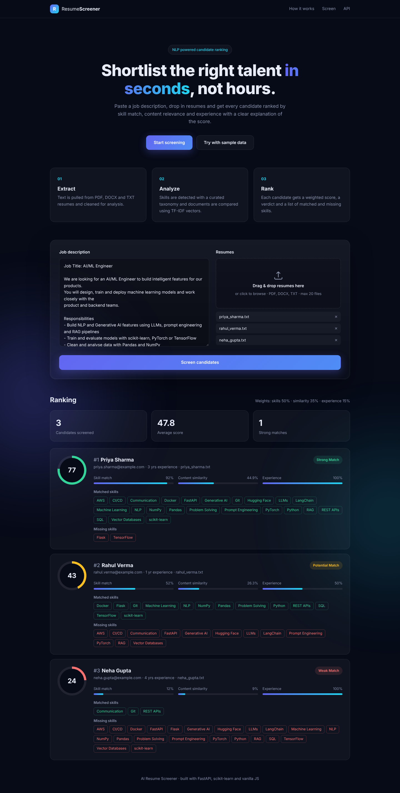

# AI Resume Screener

A web app that ranks resumes against a job description using Natural Language Processing.
Paste a job description, upload a set of resumes (PDF, DOCX or TXT) and get every candidate
scored from 0 to 100 with a clear breakdown of **why** they got that score.



## Features

- Upload up to 20 resumes at once (PDF, DOCX, TXT) with drag & drop
- Skill extraction using a curated taxonomy of 45+ technical and soft skills (with aliases like `sklearn` → `scikit-learn`)
- Content similarity using **TF-IDF vectors** and **cosine similarity**
- Experience detection from phrases like "3+ years of experience"
- Weighted, explainable score with matched and missing skills for each candidate
- Ranked results with verdicts: *Strong Match*, *Potential Match*, *Weak Match*
- REST API with auto-generated docs at `/docs`
- One click sample data to try it out

## How the scoring works

| Signal | Weight | How it is calculated |
| --- | --- | --- |
| Skill match | 50% | `matched skills / skills required in the job description` |
| Content similarity | 35% | TF-IDF (unigrams + bigrams, stop words removed) cosine similarity, rescaled to 0-100 |
| Experience | 15% | `candidate years / required years`, capped at 100% |

```
score = 0.50 * skills + 0.35 * similarity + 0.15 * experience
```

- **70+** → Strong Match
- **40 - 69** → Potential Match
- **below 40** → Weak Match

Skill matching rewards resumes that contain the exact tools the job asks for, while TF-IDF
similarity captures the overall context (responsibilities, domain, wording) that a plain
keyword search would miss.

## Tech stack

- **Backend:** Python, FastAPI
- **NLP / ML:** scikit-learn (TfidfVectorizer, cosine similarity), regex based entity extraction
- **File parsing:** pypdf, python-docx
- **Frontend:** HTML, CSS, vanilla JavaScript
- **Testing:** pytest
- **Deployment:** Docker / Render

## Project structure

```
ai-resume-screener/
├── app/
│   ├── main.py        # FastAPI app and API routes
│   ├── parser.py      # text extraction from PDF / DOCX / TXT
│   ├── skills.py      # skill taxonomy and skill extraction
│   ├── scorer.py      # similarity, experience and final scoring
│   └── static/        # frontend (index.html, styles.css, app.js, sample data)
├── tests/             # unit and API tests
├── Dockerfile
├── render.yaml
└── requirements.txt
```

## Getting started

```bash
git clone https://github.com/ARPANPATRA111/ai-resume-screener.git
cd ai-resume-screener

python -m venv venv
source venv/bin/activate      # on Windows: venv\Scripts\activate
pip install -r requirements.txt

uvicorn app.main:app --reload
```

Open http://localhost:8000 and click **Try with sample data**.

### Run with Docker

```bash
docker build -t resume-screener .
docker run -p 8000:8000 resume-screener
```

## API

`POST /api/screen` (multipart form)

| Field | Type | Description |
| --- | --- | --- |
| `job_description` | text | The full job description |
| `resumes` | file (multiple) | Resume files to rank |

```bash
curl -X POST http://localhost:8000/api/screen \
  -F "job_description=<app/static/samples/job_description.txt" \
  -F "resumes=@app/static/samples/priya_sharma.txt" \
  -F "resumes=@app/static/samples/rahul_verma.txt"
```

Example response (trimmed):

```json
{
  "weights": { "skills": 0.5, "similarity": 0.35, "experience": 0.15 },
  "results": [
    {
      "candidate": "Priya Sharma",
      "score": 76.7,
      "verdict": "Strong Match",
      "breakdown": { "skills": 92.0, "similarity": 44.9, "experience": 100.0 },
      "matched_skills": ["Docker", "FastAPI", "LangChain", "PyTorch", "Python", "RAG"],
      "missing_skills": ["Flask", "TensorFlow"],
      "years_experience": 3
    }
  ]
}
```

## Running tests

```bash
pip install -r requirements-dev.txt
pytest
```

## Deployment

The repo includes a `render.yaml`, so it can be deployed on [Render](https://render.com) for free:
**New → Blueprint → select this repository**. Any platform that runs Docker works as well.

## Limitations and future work

- TF-IDF matches words, not meaning, so "ML" and "model training" are not seen as related.
  Sentence embeddings (e.g. `sentence-transformers`) would improve this.
- Alternatives in a job description ("PyTorch or TensorFlow") are treated as separate requirements.
- An LLM could generate a short written summary of each candidate's strengths and gaps.
- Scanned (image only) PDFs need OCR before they can be scored.

## License

MIT
